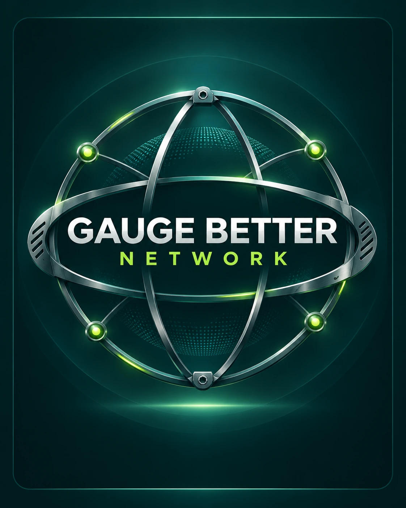

<p align="center">
  
</p>

<h1 align="center">Gauge Better Network</h1>
<p align="center"><strong>The Best Estimates. The Strongest Partnerships.</strong></p>
<p align="center">Connecting builders, developers, structural-steel suppliers, independent installation contractors, complete work crews, and skilled construction professionals.</p>
<p align="center">
  <a href="#the-gauge-better-network-vision">Our vision</a> ·
  <a href="#what-the-website-includes">Website features</a> ·
  <a href="#repository-file-guide">Project files</a> ·
  <a href="#how-developers-can-help">Help with launch</a> ·
  <a href="https://github.com/BishopSD/Gauge-Better-Network/issues">Issues</a>
</p>

> **Website design and feature scope: finished.** This is the owner-approved Gauge Better Network website design, prepared for testing and launch. **We are not seeking a redesign or an expansion of the approved features.** Help is welcome with reviewing the existing code, fixing confirmed defects, checking security and accessibility, connecting and testing required production services, and preparing a reliable deployment. Changes to site design or business rules need owner approval first.
>
> **Repository / deployment note:** The GitHub source is an imported contributor baseline. It has **not been verified as identical to the current hosted version**, and the full production backend is not included here. Do not assume that a visible form, payment interface, or owner dashboard is already live and operational. This is a verification and integration matter, **not a request to redesign the finished site**.

## The Gauge Better Network vision

**GBN is a connection and estimate-comparison network — not a steel manufacturer, retailer, licensed construction contractor, employer, or engineering firm.**

A builder should be able to bring one construction project to GBN and find the right steel materials, supplier estimates, installation services, and skilled people needed to move it forward. The goal is to make opportunities and comparisons easier for every party involved.

**Who the network serves**

| Participant | How GBN helps |
| --- | --- |
| **Builders and developers** | Submit projects, request structural-steel material estimates, compare scope and costs, and connect with qualified suppliers and installers |
| **Manufacturers, distributors and fabricators** | Be considered for sourcing requests and opportunities relevant to their materials and capabilities |
| **Independent contractors and crew companies** | Connect with builders looking for complete installation crews, specialty teams, or other construction labor |
| **Individual skilled professionals** | Join the labor network for free and present trade skills, service areas, availability, requested hourly pay, and a résumé |
| **GBN owner/operator** | Review project submissions and partners, coordinate separate material and labor quotes, manage follow-ups, and approve sharing and access |

GBN starts with **California-based projects and relationships**. Its sourcing strategy prioritizes American suppliers while allowing transparent comparison with qualified international sources where appropriate. Relevant comparisons should disclose origin, product specifications, freight, import costs, tariffs, lead times and applicable California/U.S. compliance requirements.

### How a project moves through GBN

```text
Builder / developer submits project details and plans
                         |
                         v
         GBN reviews scope and requirements
                  /              \
                 v                v
      Materials suppliers    Independent installers
       prepare estimates      quote labor / crew work
                  \              /
                   v            v
         GBN organizes comparable information
                         |
                         v
      Builder chooses suppliers and installation teams
```

- Project submissions are intended to be **free**.
- Material quotes and installation/labor quotes are **separate** so builders can make informed choices.
- An access fee for approved comparable estimates, if applicable, is **project-specific and shown before checkout**.
- Any separate referral or sourcing-service compensation is **negotiated privately**, rather than advertised as a universal percentage.
- Individual worker registration is intended to be **free**.
- GBN does not automatically award projects, hire workers, order materials, or contact companies on a contributor's behalf.

See the existing [vision and visitor workflow page](public/vision.html).

## What the website includes

The finished site design contains these sections and interface capabilities:

- **Structural-steel materials catalog:** cold-formed framing, structural shapes, HSS, plate, joists, trusses, decking, cladding, reinforcement, specialty metals and related products.
- **Interactive 3D examples:** visual steel component illustrations with rotation controls, alongside project and product photography.
- **Building applications:** residential, multifamily, commercial, industrial, agricultural, modular, prefabricated and other steel-building uses.
- **Project and estimate interfaces:** builder project entry, drawing uploads, supplier invitations, independent material quote comparisons and installation requests.
- **Installation and labor network:** independent contractors, crew companies, and individuals ranging from superintendents and specialists to laborers.
- **Skilled-professional signup:** free worker profiles with contact information, specialty, location, availability, pay expectations and PDF résumés; controlled builder access is intended.
- **Owner and partner coordination interfaces:** supplier/contractor review, partner information, prospective matches, approvals, and estimate management.
- **Business information and safeguards:** sourcing guidance, project-scope explanations, privacy notices, terms drafts and service disclaimers.

**Important distinction:** These sections and workflows exist in the site design and/or client code; that does **not** verify working production submissions, storage, authorization, payments, or deployment. Those integrations must be tested separately.

## Repository file guide

These are the **actual folders and files in this GitHub repository**:

| Path | Purpose |
| --- | --- |
| [`public/index.html`](public/index.html) | Approved homepage structure, navigation, material catalog and project entry points |
| [`public/styles.css`](public/styles.css) | Brand styling, responsive layouts, page and form components |
| [`public/app.js`](public/app.js) | Browser-side project, estimates, suppliers, installers, portal and payment UI |
| [`public/network-ui.js`](public/network-ui.js) | Partner/network management UI, directory and GBN Guide interface |
| [`public/material-models.js`](public/material-models.js) | Interactive 3D steel-material illustrations |
| [`public/labor/`](public/labor/) | Skilled-worker application and builder labor-search pages |
| [`public/preview-pages/`](public/preview-pages/) | Additional pages covering building types, estimates, suppliers and installations |
| [`public/legal/`](public/legal/) | Legal, privacy, sourcing and compliance **drafts for final review** |
| [`public/assets/`](public/assets/) | GBN logo and existing website imagery |
| [`public/vision.html`](public/vision.html) | Plain-language explanation of the GBN project workflow |
| [`public/preview-safety.js`](public/preview-safety.js) | Preview-mode safety logic |
| [`worker/api.js`](worker/api.js) | Partial hosted API code for worker profiles, résumés and approved builder access |
| [`.github/workflows/check.yml`](.github/workflows/check.yml) | Automated JavaScript syntax and link-entry checks |
| [`.github/pull_request_template.md`](.github/pull_request_template.md) | Pull-request test and owner-review questions |

### Important backend boundaries

The static `public/` preview does not provide a complete working backend. The browser scripts call several `/api/...` endpoints, but this repository does not contain all the services used by the hosted site. The included `worker/api.js` refers to generated `ownerDigest` and `files` values and requires authenticated hosting plus a `BUCKET` binding. **Do not publish secrets, customer data, résumés or private construction drawings to GitHub.**

Some existing sourcing UI code still contains restrictions from a previous sourcing policy, including an exclusion of China-based suppliers. The owner's later direction allows global sourcing comparisons, including Chinese suppliers, with transparent origin and fully landed costs. **Flag the difference for owner review; do not independently change the site's approved business rules or claim the global sourcing integration has been completed.**

## Preview the finished site design locally

To inspect the existing front-end without modifying its design:

```bash
git clone https://github.com/BishopSD/Gauge-Better-Network.git
cd Gauge-Better-Network
python3 -m http.server 8000 --bind 127.0.0.1 --directory public
```

Open **http://localhost:8000**. This is for reviewing page layout, mobile behavior, links, interactions and accessibility. **It is not a production-equivalent test of submissions, payments, private files or logins.** Use fictional test information.

For JavaScript syntax checks, the GitHub Actions workflow already runs on pushes and pull requests. On Unix-like systems with Node.js installed, you can also run:

```bash
find public worker -name '*.js' -exec sh -ec 'for file do node --input-type=module --check < "$file" || exit 1; done' sh {} +
```

## How developers can help

**We need help protecting and launching the site we've already built — not starting the design over.**

Useful contributions include testing the existing pages and workflows, reporting reproducible defects, improving security and accessibility without changing the visual design, reviewing backend integration assumptions, and helping verify a safe launch. The owner decides whether any proposed change becomes part of the site.

### Existing GitHub issues

- [#1 — Test project-request forms on mobile and with keyboard navigation](https://github.com/BishopSD/Gauge-Better-Network/issues/1)
- [#2 — Review site code for mistakes](https://github.com/BishopSD/Gauge-Better-Network/issues/2)
- [#3 — Verify submitted builder projects reach the GBN owner dashboard](https://github.com/BishopSD/Gauge-Better-Network/issues/3)
- [#4 — Verify payment unlocks the correct project's estimate](https://github.com/BishopSD/Gauge-Better-Network/issues/4)

[See all issues](https://github.com/BishopSD/Gauge-Better-Network/issues) · [See pull requests](https://github.com/BishopSD/Gauge-Better-Network/pulls)

### Contributing without disturbing the approved website

1. Select an existing issue or report a specific, reproducible defect.
2. Fork this repository and create a focused branch.
3. Keep changes as small as possible. **No unsolicited redesigns, new sections, altered fee policies, or removed features.**
4. Describe what changed and exactly how you tested it. Use fictitious data and safe screenshots.
5. Open a pull request. **The GBN owner reviews it before any change is merged.** Do not deploy to the live website without approval.

### Launch validation focus

This is a **testing checklist**, not a list of website redesign requests:

- [ ] Confirm this repository accurately reflects the owner-approved finished site.
- [ ] Check mobile layouts, keyboard navigation, forms and accessibility.
- [ ] Verify builder project submission and owner receipt in a protected test environment.
- [ ] Verify supplier and contractor invitations, permissions, quotes and scope comparison.
- [ ] Verify free skilled-worker signup, restricted résumé access and profile withdrawal.
- [ ] Test fees and project-specific quote unlocking with a payment **sandbox** only.
- [ ] Review secure hosting, identity, storage, backups and configuration.
- [ ] Resolve discrepancies between older source text and the owner's approved sourcing policy.
- [ ] Review legal/privacy disclosures before live collection of payments or personal data.
- [ ] Perform final launch checks and obtain owner sign-off.

## Project ownership and reuse

This is a public GitHub repository, but **no standalone open-source `LICENSE` file is currently present**. Public visibility alone does not grant permission to copy, redistribute or commercially deploy the project. If you want to contribute, use the GitHub issue and pull-request process.

**Gauge Better Network — California-first construction connections, broader sourcing opportunities, and better estimates through stronger partnerships.**
